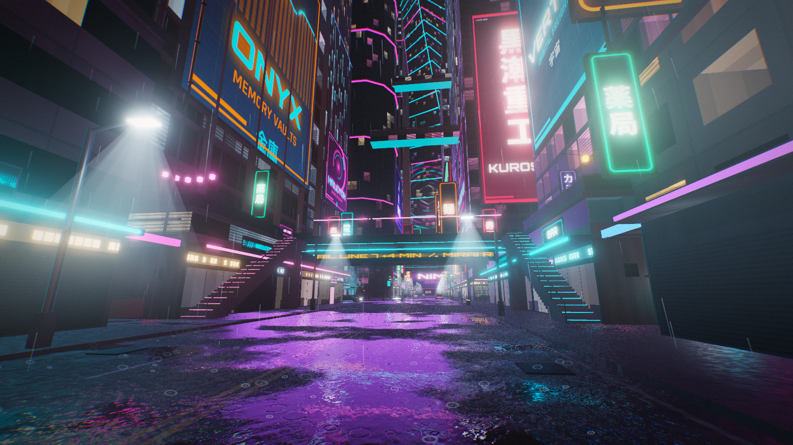
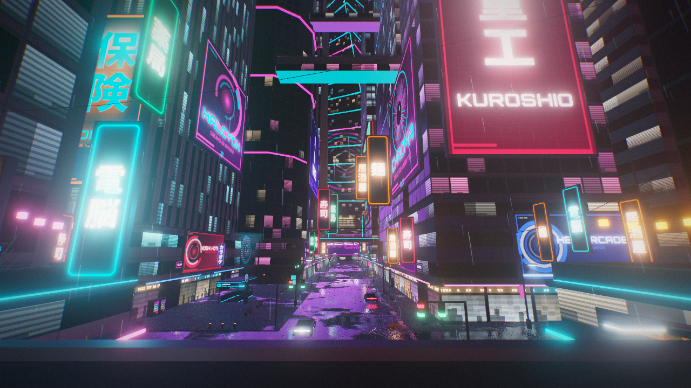
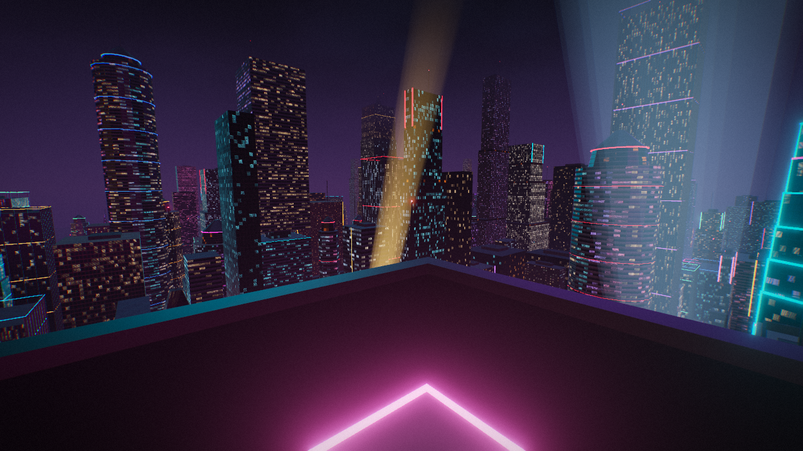
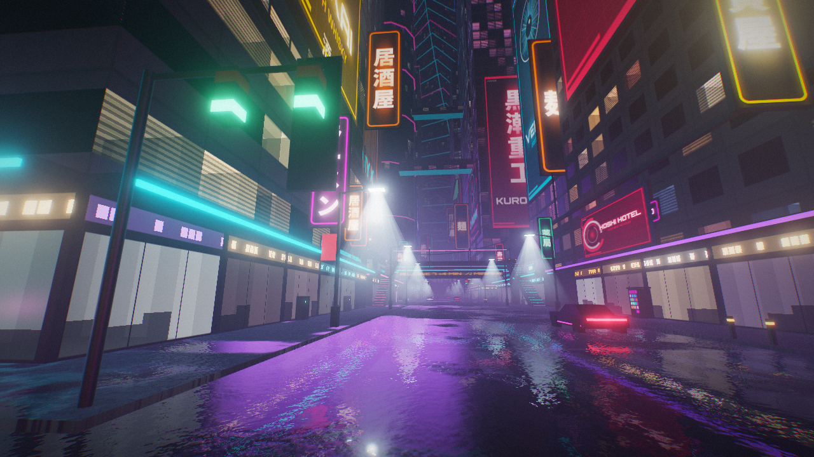
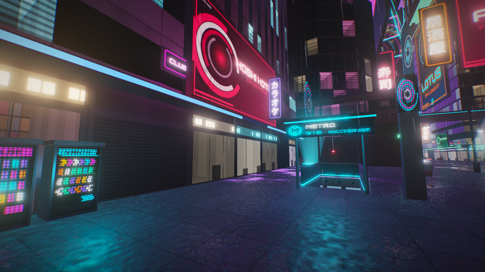

# NEON CITY

A first-person walk through a rain-soaked cyberpunk megacity, built with **Three.js (WebGL 2)** and
nothing but procedural content. There are no missions, enemies or objectives — you just explore.

```bash
npm install
npm run dev        # http://localhost:5173
npm run build      # static bundle in dist/
```

## Controls

| Input | Action |
| --- | --- |
| `W A S D` / arrows | walk |
| Mouse | look |
| `Shift` | sprint |
| `Space` | jump |
| `E` | use a lift |
| `1` – `4` | weather: clear · light rain · heavy rain · dense fog |
| `Esc` | release the mouse / settings (weather, graphics, sensitivity, FOV, volume) |

## Places to find

- **Halcyon Avenue / Kaizen Street** – the main crossing, lined with shopfronts, blade signs and
  façade-sized LED screens. Each of the four street axes ends in a landmark.
- **The skybridge** – stairs on both sides of the avenue lead to terraces and a bridge at +7 m.
- **Hoshi Hotel sky deck** – take the lift (pink door on the avenue, `E`) to a roof bar at 312 m.
- **Metro concourse** – steps down from the corner plaza north-west of the crossing.
- **Market lane** (north-east), **residential megablocks** (north-west), **tank farm and
  chimneys** (east) and the dark service alleys that cut through every block.
- **Landmarks** – the twisting OMNI-HELIX spire (north), Kuroshio Arcology (west),
  Meridian Twins (south) and Orbit//9 (east).

## How it is built

| Path | Responsibility |
| --- | --- |
| `src/main.js` | bootstrap, settings, frame loop |
| `src/config.js` | street grid, palettes, quality and weather presets |
| `src/world/geo.js` | merged-geometry builder (the whole city is a few dozen draw calls) |
| `src/world/materials.js` | PBR façade shader (procedural windows + interior mapping), wet ground, LED screens / neon / holograms, volumetric glow, sky |
| `src/world/ads.js` | paints every advert and sign into one 4096² atlas with the 2D canvas |
| `src/world/buildings.js` | podium + eight tower typologies, roof kits, billboards, signage |
| `src/world/street.js` | lamps, vending machines, alley clutter, cables, vents |
| `src/world/infra.js` | elevated railway, expressway, skybridge, metro, sky deck |
| `src/world/landmarks.js` | the four hand-designed megastructures |
| `src/world/city.js` | district zoning, block subdivision, mid ring and far skyline |
| `src/render/fog.js` | analytic height fog + cloud deck patched into every material |
| `src/render/reflection.js` | planar reflection for the wet streets |
| `src/render/postfx.js` | HDR composer: MSAA, bloom, ACES grade, vignette, grain |
| `src/fx/` | rain and splashes, steam, pooled dynamic lights, cars, flyers, trains, searchlights |
| `src/player/` | controller and box/step collision |
| `src/audio/ambience.js` | procedural Web Audio soundscape |
| `src/ui/` | loading / start / pause interface |

Fonts (Orbitron, Rajdhani, Noto Sans JP) come from the `@fontsource` packages under the SIL Open
Font License. No other external assets are used; all brands shown are fictional.

## Screenshots






